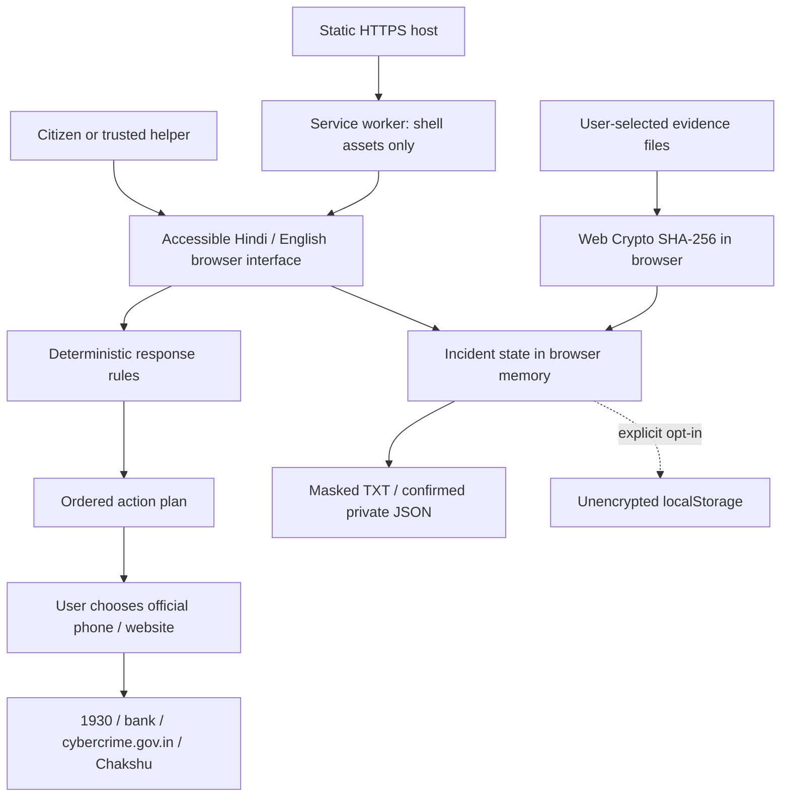

# Technical Design Document

Version 1.0, 26 October 2026. Status: functional prototype; field evaluation pending.

## Problem and boundary

People who suspect a digital financial scam need an immediate action and a clear route to official assistance. Sanket addresses the preparation and handoff workflow for Hindi/English users, including older adults and first-time digital-payment users with a trusted helper. It complements existing systems. It does not investigate, classify messages as safe, process payments or file reports.

## Architecture

The final arrow represents an external user action, not an API integration. Incident records and file contents never go to the static host. Hosting providers can still process ordinary request metadata such as IP addresses and access logs.

## Components

| File | Responsibility |
|---|---|
| dist/index.html | Semantic page structure, labels, official links, Content Security Policy |
| dist/style.css | Responsive layout, contrast, visible focus, reduced motion |
| dist/engine.js | Pure decision rules, input validation, redaction, report serialization, restore validation |
| dist/app.js | Language switching, navigation, incident state, hashes, exports, practice |
| dist/sw.js | Versioned allowlist cache of application assets |
| scripts/serve.mjs | Loopback-only development server with path containment checks |
| tests/engine.test.mjs | Domain and privacy tests using Node's built-in runner |

## Decision contract

All selected flags are considered together. Remote access always adds device isolation first. Financial loss then adds 1930 before evidence preparation. Exposed credentials add account security. Loss, credential exposure or remote access route to cybercrime.gov.in. Suspicious communication alone routes to Chakshu. No selection produces no specific plan. Rules have a visible review date and a version constant. Invalid flags are ignored and duplicate steps are removed.

## Data model

Incident: amount (optional decimal string, INR), local date/time, provider, transaction reference, payment channel, narrative (max 1,200 characters), and file metadata (name, byte size, SHA-256). No name, government ID, password, OTP, PIN, full card number or account-number field exists. Users may still accidentally include sensitive information in narrative text; the sharing export therefore withholds the entire narrative rather than attempting unreliable automatic redaction.

Default state lives only in memory. Opt-in storage retains the incident in this browser. Situation selections, language, quiz answers and scores are not persisted. Export includes time-zone metadata. No import feature accepts external incident files.

## Evidence integrity

The file picker reads at most five files, 10 MiB each and 30 MiB total, one file at a time. Web Crypto computes SHA-256. Duplicate hashes are omitted. Only metadata enters state. No originals or thumbnails are uploaded or retained by the app. Hashes help compare byte-identical files; they do not verify origin, author, time of capture or legal admissibility.

## Offline and updates

The service worker caches the seven shell resources after a successful initial visit. Requests use network-first with cache fallback for the allowlisted same-origin assets only. This keeps official reporting pages and user records outside the cache. It removes only older Sanket cache versions in its origin. Publishing changes should increment the shell cache version. Offline use does not make phone calls or external websites available. First-ever use requires connectivity; storage eviction can remove cached assets.

## Security, accessibility and scaling

User-entered text is rendered with textContent, not HTML. The CSP rejects third-party scripts, forms and connections. There is no analytics SDK, remote font, cloud AI or database. The static host serves the same assets to all visitors; user records do not create a central scaling bottleneck. This architecture is not a load-test result.

Inputs have visible labels, controls have keyboard focus indicators, pages use semantic headings, live announcements communicate errors, and Hindi changes the document language. The layout collapses at 800px. Accessibility certification, screen-reader testing and broad device testing remain pending.

## Alternatives and tradeoffs

We selected deterministic rules instead of an LLM because urgent steps must be inspectable, available offline and inexpensive. The tradeoff is narrow coverage, no free-form classification and ongoing editorial review. Local state limits central exposure, but prevents cross-device sync and creates shared-device risks. The app intentionally asks fewer details than the official reporting system: it reduces preparation burden but cannot replace the official process.

## Future work, not implemented

Native-language review, additional local languages, a community distribution pilot, updated guidance governance, assisted accessibility testing and evaluation of whether durable encrypted drafts are necessary. No automatic complaint API or bank integration is assumed. Speech features and OCR are not part of this version.
